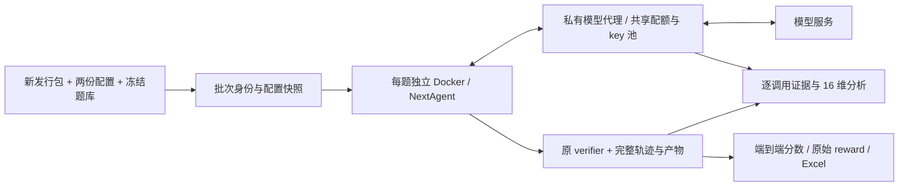

# NextAgent 长期 SkillsBench 评测

独立项目：`C:\Project\nextagent-bench`。接受新的 Linux x64 NextAgent 编译包，使用 Docker 执行题目；不修改 NextAgent 产品代码，不自动给新包套用历史补丁。

旧 session 与旧工程的复盘保存在 [历史评测复盘](docs/legacy-review-20261025.md)。该文是建设前的调查结论；最终已实施的运行方式以本文及 [验证记录](docs/VALIDATION.md) 为准。

历史单题曾通过；实际耗时、5-key 轮换、代理断连修复，以及“支持可配置并发但当时有效并发为1”的边界，见 [冒烟记录](docs/SMOKE-20261025.md)。

原全量批次 `20261025-195147-f17d59ed-c79fa2` 已按用户要求停止，原始结果保留。结果入口见 [评测结果索引](RESULTS-INDEX.md)。用户于 2026-10-26 单独批准恢复诊断 Hook 后重跑 `ada-bathroom-plan-repair` 和 `azure-bgp-oscillation-route-leak`，补测批次为 `20261026-161356-f17d59ed-b0c82d`；不自动恢复原全量剩余任务，也不覆盖首测分数。



## 以后换包时怎么启动

在 PowerShell 中运行：

```powershell
cd C:\Project\nextagent-bench
.\Start-Evaluation.ps1 -Framework "C:\Users\xiaodongma\Downloads\新的-nextagent-linux-x64.tar.gz" -Suite smoke -Background
```

冒烟通过后启动全量：

```powershell
.\Start-Evaluation.ps1 -Framework "C:\Users\xiaodongma\Downloads\新的-nextagent-linux-x64.tar.gz" -Suite full -Jobs 2 -Background
```

也可以指定单题或多个题，不需要修改脚本：

```powershell
.\Start-Evaluation.ps1 -Framework "C:\Downloads\新包.tar.gz" -Tasks 3d-scan-calc,dialogue-parser -Jobs 2 -Background
```

省略 `-Background` 会在当前终端执行。后台使用隐藏窗口，进度/错误写到 `launches/`；stdout 开头的 `RUN_DIRECTORY=` 是此次批次目录。框架路径支持 tar.gz，也支持明确的已解压部署目录，后者在工件记录中标为 directory-snapshot。

## 首次安装与凭据

本机已执行安装和旧工程快照导入；日常不必重新安装。换电脑或重新取得源代码时：

```powershell
.\Setup.ps1
.\Set-ModelCredential.ps1
```

若是只复制了工程源代码、没有复制 artifacts/datasets 缓存，首次指定来源：

```powershell
.\Setup.ps1 -Framework "C:\Downloads\nextagent-linux-x64.tar.gz" -Dataset "C:\Project\skillsbench-main"
```

需要 Python 3.12+、Docker Desktop/Engine 和模型 API 接入。Setup 创建项目自己的 `.venv`，安装固定版本依赖并运行离线契约测试，再导入 `evaluation.yaml` 指定的框架和题库。

模型凭据使用 Windows 当前用户 DPAPI 加密，按别名保存在 `.secrets/keys/<别名>.xml`，不进入 Git 或结果。同一 Windows 用户后续直接启动即可。添加多个 key 时逐个在本机隐藏输入，不需要发到聊天：

```powershell
.\Set-ModelCredential.ps1 -Name account-key-1
.\Set-ModelCredential.ps1 -Name account-key-2
.\Set-ModelCredential.ps1 -List
```

同名保存会替换该 key，`-Remove -Name <别名>` 删除指定 key。已有旧工程 key 已迁入 `default`。也可通过 `OPENAI_API_KEY` 临时加入池，重复值会去重；高级环境变量 `NAB_API_KEYS` 可明确覆盖池。真实 key 只送到 Docker 内部模型代理，Agent 容器只拿到临时本地凭据；代理不发布主机端口。拥有 Docker 管理权限的人仍能查看运行中容器环境，所以加密存储不等同于防御本机管理员。

模型名称、地址和请求任务并发在 `evaluation.yaml`：当前基线为 `qwen3.8-27b`。smoke 为 `3d-scan-calc`、`dialogue-parser`；telecom 为现有两道网络题。full 使用冻结快照中的全部默认任务。

**这些 key 已确认共享同一账号/项目配额，不能按 key 数叠加额度。** `profiles/model-quota.yaml` 统一控制总并发、RPM/TPM、启动间隔、限流等待和重试次数。未知 RPM/TPM 保持 null；默认起步并发已按用户授权改为 2，当前批次由运行时控制文件调节，监控最高逐级升至 4。共享额度仍统一计算。轮换只用于均衡使用和隔离失效凭据；429 会使整个池冷却，不会换 key 继续冲击同一额度。仅明确的 429、401/403 可在成功响应之前有界重试；开始输出的流和传输断点不自动重放，以免产生重复执行或掩盖故障。

本项目同时只允许一个消耗模型的评测/分析批次，防止各自独立计算共享额度。旧工程、外部客户端或另一份本项目副本无法受这个本地锁约束；它们的消耗仍占同一账号额度。旧后台评测保持原状，本项目不擅自停止它。代理记录每个别名的请求数、状态、冷却和任务/分析用途，均不含 key 值。

## 两份配置文件

- `profiles/default-system.yaml`：来自用户在 Downloads 解压目录里修改的系统配置。保留模型 env 引用、temperature、token/context/进展超时、memory、gateway 等设置。
- `profiles/agent.yaml`：来自同一目录的 Agent 配置。保留 `guardrailEnabled=false`、maxTurns、maxToolCallsPerTurn、requestTimeoutMs、能力绑定等设置。

这两份文件是长期维护的评测模板；更换产品包不会覆盖它们，也不会复用包内历史数据库、日志或 workspace。

每次运行生成并冻结实际配置，默认仅做必要的评测隔离：四个路径指向本题独立 NEXTAGENT_HOME；HTTP 使用容器内部 31872 端口，避免与网页任务的 3000 端口冲突；信任身份只使用容器内 LOCAL auth none；activeAgentId 对应本地定义。修改列表写入 `runs/<run-id>/config/changes.json`。

开发诊断插件和 `developer-hook-trace.loop-raw-boundary` 的六阶段绑定由上述两份配置直接声明。评测器不删除、补写或强制启用 Hook，不再支持 `excluded_agent_hooks` 过滤，也不增加额外的 Hook 启动校验；由框架使用自身的配置、插件装配和轨迹写入机制，评测器原样归档生成的日志。旧工程曾因 `Unknown lifecycle hook` 排除该绑定，导致原全量批次缺少 `DEVELOPER_HOOK_TRACE/boundary`；这个历史缺口不能事后补回。2026-10-26 已在同一被测工件的两题补测中采集到开发诊断边界日志。原批次配置和首测分数保持不变。

有效 Agent 定义会在启动前放入 `NEXTAGENT_HOME/agents/<agentId>/agent.yaml`，并用 bootstrap.guardrail 核对实际护栏值，防止回退到 guard=true 的内置定义。题目系统 Skills 在启动前准备。Web `/api/v1/skills` 只列出 user-invocable Skills，因此还会读取结构化 system-local 注册诊断，验证模型可发现的普通 Skills；证据分别保存，缺失时停止该题接入，不把“文件已复制”当作加载成功。

框架升级若引入配置 schema 变化，启动检查会报告错误；不会自行丢弃用户配置或悄悄回退。对比两个框架时应使用相同模型、配置、题库、路径映射与适配器版本；这些身份全部保存在 manifest 中。

## 题库路径适配

首次导入把现有 `C:\Project\skillsbench-main\tasks` 完整保存为内容寻址快照。它已经包含历史经用户授权的路径改动，来源会记录为“现有已适配题库”，不会伪称原始上游。旧题库不再被本项目改写。

正式执行时以 **Docker 最终镜像的 WORKDIR** 为准，不使用第一个 WORKDIR 或只取 `/app` 前缀；支持多阶段、ENV WORKSPACE 和嵌套工作目录。离线 plan 是预测值，运行时总会用 inspect 的真实值重新生成适配结果。

| 原路径 | Agent 逻辑路径 | 实现 |
|---|---|---|
| 本题 WORKDIR，如 `/root`、`/app`、`/app/workspace`、`/home/travis` | `workspace` | 把题目输入移入 scope workspace，原目录建立可验证链接 |
| 额外 `/data` | `workspace/_roots/data` | 保留独立根，不与主目录混合 |
| 额外 `/output` | `workspace/_roots/output` | 原 verifier 仍可读 `/output` |
| `/opt/syzkaller` 等明确任务工具链 | `workspace/_roots/opt/syzkaller` | 仅按本题显式映射迁移，原路径继续可用 |
| `/tmp` | `temp` | 物理路径与本 scope 的 temp 根桥接 |
| Skill 的旧 `.claude/skills` 路径 | `workspace/skills` | 题目资源副本与发现用 system Skill 分开准备 |

额外根的唯一配置在 `profiles/path-mappings.yaml`。已补上 Civ6 的 /data+/output、Druid、Flink、React 任务辅助目录、syzkaller；其他历史跳过的任务大部分由完整 WORKDIR 映射处理。fix-visual-stability 的 `/api` 是服务目录/路由，不做全局文本替换，由原 Compose 辅助服务承载。不修改 verifier/oracle/Dockerfile 正文，不把多个不同物理根压成同一个目录，不改 URL。

每题留下原 task.md、实际 prompt、Skill 资源、适配 patch、映射 JSON、原 verifier 摘要及路径桥接结果。系统根和 evaluator 根禁止迁移；文件冲突、目录数量不符或 Skill 缺失会停止该题接入，明确记录，不当作通过。

查看全部路径计划（不调用模型）：

```powershell
.\.venv\Scripts\python.exe -m nextagent_bench plan --suite full
```

网页任务的原 Compose 辅助服务会启动在本批次独立网络中；不发布主机端口，不挂载主机 gcloud 凭据，相关差异存入 compose-changes.json。原始声明里的其他未知卷挂载会明确拒绝，避免隐式改变数据源。

## 结果、日志和完整产物

```text
runs/<run-id>/
  manifest.json                 包/题库/模型/配置/适配器身份、运行状态
  config/                       两份有效配置、修改记录、冻结路径策略
  adapter-source/               本批次实际执行的适配器与启动脚本源码
  model-gateway/<session>/
    identity.json / metrics.json / events.jsonl  共享配额、别名计数与安全事件
    exchanges.tar               实际消息、tools/schema、provider 分片与调用 ID
  framework-build.log
  summary.json                  覆盖率、结果分布、完整分数（未完成则为空）
  results.json / results.csv
  results.xlsx                  批次概览、首次有效结果、全部尝试
  report.md
  tasks/<task>/attempt-001/
    result.json                 增量落盘，不必等整题结束
    phase-timing.json
    agent-facing/               原任务、实际 prompt、Skills、适配 patch/映射
    bootstrap.json / skill-catalog.json / skill-discovery.json / path-bridge.json
    priming.json / priming-trajectory.jsonl
    trajectory.jsonl            正式请求的增量事件，不混入 priming
    final-answer.txt
    nextagent-home.tar           完整运行数据、日志、Skills、workspace，保留 Linux 链接
    nextagent-home/logs/         便于分析的日志副本
    runtime/                    启动日志及运行状态
    verifier-logs/              原 verifier 输出及其 artifacts
    ctrf.json / reward.txt / verifier-stdout.txt
    failure-analysis.md          现象和可定位证据，未证实根因明确写未知
    tool-boundary-checks.json    按 ID 对照 wire 参数、归一化、执行输入和下一轮反馈
    analysis/latest.json        最新分析状态与报告位置
    analysis/<revision>/
      packet.json               原始证据索引和选取内容
      prompt-packet.json         实际送给分析模型的有界证据包及遗漏清单
      model-response.json       分析模型输出与 usage
      analysis-settings.json / analysis-implementation.py  分析配置、提示与实现快照
      deterministic-audit.json   确定性事实与模型结论的冲突、核验边界
      diagnosis.json / report.md 结构化归因和可阅读的详细报告
```

工作区实际位置写在 path-bridge.json；完整归档中的位置是 `home/workspaces/execution/<scope>/workspace/`。使用 tar 保留 Linux 符号链接及文件名，避免 Windows 直接接收 node_modules/链接时失败；可用 7-Zip 或在 Linux 上解包检查。只额外提取日志供报表读取，不重复复制整个工作区。operation / operational / diagnostic 文件只要由框架生成，都会随完整 home/logs 和 deployment-run 采集；未生成的日志不会伪造。

采集异常、缺 reward、verifier 安装/超时、框架错误分别记录。框架 REQUEST_FAILED 仍作为端到端失败，保留原始 verifier 的产物分数；不会统一改成 N/A 掩盖产品问题。没有自动“重新跑到成功”。诊断重试放在新 attempt，使用全新容器和状态；第一次有效失败不会被后来的成功覆盖。

Excel 使用真实模型名、CTRF status 和独立阶段耗时。token 从该正式 request 的 normalized modelOutput.usage 汇总；缺失就为空，不估算、不补零。完整回答和 prompt 在独立文件里，不受 Excel 单元格限制。Skills 分别统计已提供、已发现、实际调用、成功加载，避免把复制成功当成真正使用。

## 失败分析的深度与证据

默认失败后自动分析；不会运行模型建议的修复命令，不改变被测包、原始 reward 或 score。分析使用 `profiles/analysis.yaml` 指定模型，空值跟随被测模型；可单独换分析模型重做诊断，不必重跑 Agent。

分析覆盖 16 个维度：任务与验收、路径/Scope、指令组装、上下文/截断、工具 schema、provider 协议、模型规划行为、参数契约、框架分发校验、安全拒绝、工具环境、反馈与修正、恢复/副作用、产物与 verifier、配额/时延、评测器与题库。

每个失败建立因果链：任务要求 → 实际送给模型的指令/工具定义 → provider 原始参数分片 → 框架 normalized tool call → 实际 toolInput/校验/执行结果 → 下一轮模型真正收到的错误反馈 → 修正行为 → 最终产物和 verifier 断言。按 tool-call ID 联结，并直接执行 JSON/schema 校验及参数一致性比较。由此可分别识别模型违反可见契约、契约描述/隐藏约束不一致、合法分片处理问题、反馈丢失、路径冲突、依赖错误等，也允许框架、模型及交互各自有优化项。

报告逐项引用证据 ID，包含观察事实、候选根因、置信度、替代解释、缺失证据，以及按责任方拆分的建议和能区分责任的回归验证。自动语义分析仍需人工核验；没有因果对照重放时，整体根因最多标为“有证据支持的假设”。16 维逐项检查不等于每项均可确定结论，缺证据明确记 INSUFFICIENT_EVIDENCE。模型分析超时、格式不完整或引用不存在的证据会标 ANALYSIS_INCOMPLETE，原始材料保留，可以重试分析。相同模型的自评可能有偏差，允许配置独立分析模型，但两者不能使用超出当前接入协议的不同服务商地址。

精确消息/schema/分片保存在独立的**本地评测证据归档**，不进入产品普通日志。它包含 SYSTEM 提示、业务输入、代码和文件内容，适合受控本机诊断；实际 API key、认证 header 与 provider reasoning 不采集。默认每次交换上限 8 MiB，截断会记录；分析提示还有明确的长度/交换数/代码数上限，未选取的原始材料保留，不把未观察到的内部模型理解当作事实。关闭 `capture_model_exchanges` 后对应结论的证据会不足。历史旧运行没有精确 wire 证据和冻结适配器时也会明确列出缺口。

不能假定接入服务会严格执行 JSON Schema 输出约束。本地会校验格式、枚举、维度和证据引用；格式不合格时最多追加一次格式修复调用，重组已保存的分析，不重跑 Agent。原回复、修复原因和修复回复分别留存。修复仍不通过时输出“分析未完成，需要核验”的报告及完整证据索引，保留原始材料，禁止静默当作已完成。该额外调用也使用同一个共享预算。

模型也可能误读证据。确定性核验会单列实际 schema 检查、工具失败和日志参数差异；例如已记录 `SANDBOX_UNAVAILABLE` 时，模型不能用“环境正常”覆盖它。检测到可直接比较的冲突会标 `REVIEW_REQUIRED` 并在报告开头、Excel 中显示。该检查只覆盖可比较事实，不证明其余语义判断都正确；报告中的根因与建议属于候选分析，需结合原始证据复核。

```powershell
.\Analyze-Failures.ps1 -Run "20261025-..." -EvidenceOnly
.\Analyze-Failures.ps1 -Run "20261025-..." -Background
```

第一条只汇集证据并执行确定性对照，不调用模型；第二条执行语义诊断。报表增加归因、置信度和详细报告位置。建议先修共同的接入阻塞项，再处理任务级失败，不因发现问题就把全量再跑一遍。

详细语义分析本身会产生额外模型开销，代理将其标为 `purpose=analysis`，与正式任务调用分开。需要优先取得全量分数时，可设 `profiles/analysis.yaml` 的 `enabled: false`，保持 `capture_model_exchanges: true`，先评测/留证，再按上面的命令分析。提示默认最多选取约 65000 字符证据，按种类轮流选择，保证指令、工具边界、代码和验收均有代表，避免重复流分片占满分析上下文。

## 查看、停止、恢复、重新生成报表

```powershell
.\Status.ps1
.\Status.ps1 -Run "20261025-..."
.\Stop-Evaluation.ps1 -Run "20261025-..."
.\Resume-Evaluation.ps1 -Run "20261025-..." -Background
.\Resume-Evaluation.ps1 -Run "20261025-..." -RetryErrors -Background
.\Export-Results.ps1 -Run "20261025-..."
```

停止使用本批次 STOP 信号；执行中的 Agent 请求取消并停止应用后才进入 verifier/归档，未启动题保持待运行。环境构建中的停止会在当前构建命令返回后生效。resume 跳过已完成题并自动重跑中断题；`-RetryErrors` 可另建 attempt 补测环境/接入/验证器错误，保留以前记录。

若框架启动或基础工具 priming 失败，批次会自动 HALTED 并保存 HALT.json，避免同一稳定阻塞项继续消耗其余 87 题。先查看证据，再用修复后的新包建立新批次；若只是外部瞬时故障，可在原配置下使用 `-RetryErrors` 恢复。

崩溃后若有陈旧 runner.lock，确认旧进程已经结束，再使用 `Resume-Evaluation.ps1 -Run <id> -Recover -Background`。进程仍活着时会拒绝恢复；恢复会按本批次标签取消、归档仍存活的旧容器，再清理其资源，新 attempt 使用干净容器，防止旧 Agent 继续消耗模型。恢复证据另存在 recovery/。通过本项目创建的容器名、Compose project 和 run 标签均唯一，不会执行全局 Docker prune 或影响旧评测。

resume 使用批次冻结的配置，不会读到新模板并覆盖旧语义；如手工改动批次配置、模型身份或适配器代码，会拒绝继续混合。改版后应建立新批次。

### 同批次调节并发与增量继续

```powershell
.\Set-Concurrency.ps1 -Run "20261025-195147-f17d59ed-c79fa2" -Jobs 2
.\Set-Concurrency.ps1 -Run "20261025-195147-f17d59ed-c79fa2" -Jobs 3
.\.venv\Scripts\python.exe -m nextagent_bench metrics "20261025-195147-f17d59ed-c79fa2"
```

运行时调节只改变待启动题目的准入和共享模型并发，不修改两份配置、题库、模型或评分。`concurrency.json` 是目标值，`concurrency-applied.json` 表示已应用；每次修改追加到 `concurrency-history.jsonl`。降档时让已有请求和题目完成，停止继续补满旧档位；实际运行数同时受内存预约限制。模型代理使用与 Agent 凭据分开的控制凭据，Agent 本身不能改变共享限额。

需要让活动题结束后暂停，可以执行 `python -m nextagent_bench drain <run-id>`，随后用 `Resume-Evaluation.ps1` 在同一批次继续。默认恢复只处理未完成/中断题，已经完成的通过、有效失败和环境错误都保留；不会自动 `-RetryErrors` 或从头重跑。后续失败分析在全部任务完成或共同接入故障 HALTED 时执行，普通暂停不反复触发全部分析。

本批次从旧静态调度器迁移到动态调度器时，先让活动题完成，保留原 manifest、代码快照及 result 文件摘要；`adapter-upgrade.json` 和 `adapter-upgrades/<sha>/` 明确记录这次用户授权的运行时升级。新题记录实际执行适配器摘要和准入时并发，已完成题不改写。恢复仍核验框架、模型、题库、冻结配置和已登记代码快照；该升级记录不是任意修改代码或产品后继续混算的通用许可。

本聊天监控按用户授权每 15 分钟观察一次。2→3→4 逐档进行，每档至少稳定 30 分钟、新增完成至少 2 题且至少 20 个模型请求，无新的限流/配额超时、上游传输或资源故障才继续；异常时暂缓或降档。策略保存在当前批次 `ramp-policy.json`，最高 4，不需要新建全量批次。

## 性能与验证边界

- 框架包在 Docker 镜像层，每题运行状态在 Linux 容器文件系统，结束后批量导出；不从 C:\ 挂载 node_modules/SQLite 热路径。
- 原任务环境及 Agent 层按内容缓存；Node 放独立 `/opt/na-eval/node`，不覆盖任务原 Node。
- 默认起步任务并发 2，运行时可以调节并同时受共享模型预算限制；镜像构建单并发，按 Docker 配置总内存的 80% 约束已运行任务的声明内存总量，每题同时设置 CPU/内存限制。
- 目前记录 storage_mb 声明，但 Docker Desktop 默认存储驱动不提供通用的逐容器磁盘配额；不宣称已执行磁盘配额。GPU/原镜像运行库不足、构建网络失败等明确记环境错误。
- priming 是建立框架 scope workspace 的独立接入请求，耗时和轨迹单列，正式题目预算从正式提交阶段计算。题目超时取原 YAML 嵌套字段，驱动不把每题扩大成统一一小时。
- 本地包副本的两个历史产品补丁仅作为初始基线现状导入，manifest 不声称它是未修改官方包；更换新 tar.gz 时不应用任何补丁。
- 全部路径计划成功不等于 87 道题均已真实跑完；完整分数只在相同批次全部任务都有有效分数时生成。换包先看 smoke，再跑 full。

本机 BenchFlow 0.6.3 的 registry 声明了 session-factory，但执行实现仍是 ACP connect/execute；为保持 NextAgent HTTP 入口与当前发行包一致，本工程没有依赖该未贯通路径，也没有改 BenchFlow 内部。PyYAML 负责原 task.md 元数据，Docker + 小型独立 runner 负责已覆盖的生命周期。后续迁移 runner 可保持冻结题库、配置、manifest 和产物定义。

## 工程测试

```powershell
.\.venv\Scripts\python.exe -m unittest discover -s tests -v
$env:NAB_DOCKER_TESTS = '1'
.\.venv\Scripts\python.exe -m unittest discover -s tests -p test_docker_integration.py -v
Remove-Item Env:\NAB_DOCKER_TESTS
```

Docker fixture 只验证路径、文件可见性、分页、HTTP 和拒绝系统根，不作为真实 NextAgent/SkillsBench 分数。真实冒烟结果及执行范围见 `docs/VALIDATION.md`。

